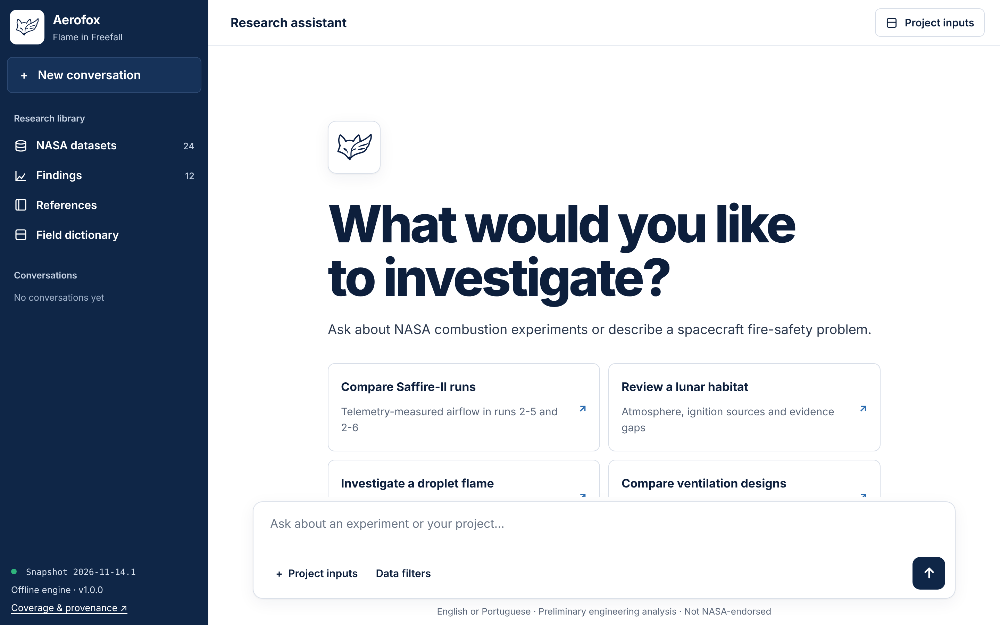

# AeroFox — evidence-grounded fire-safety assistant for spacecraft

NASA Space Apps Challenge 2026 · **Flame in Freefall: SI-Powered Fire Safety Insights from Microgravity Combustion Data**

AeroFox turns NASA's microgravity combustion archive into answers an engineer can act on. You ask a question in
English or Portuguese — about an experiment, a material, a cabin atmosphere, a lunar habitat — and AeroFox retrieves
the relevant NASA evidence, runs the calculation with deterministic tools, shows the chart or decision matrix, and
tells you which parts are measured, which are published interpretation, and where the evidence stops.

## What is inside

| Component | What it does |
|---|---|
| **Verified NASA snapshot** (`data/`) | 24 PSI combustion investigations, 22 experiment tables, 260 FLEX droplet histories, 272 FLEX test sheets, CFI files, Saffire-II telemetry extract, SAME-R aerosol results. 677 files, each with source URL and SHA-256 (`data/raw/psi/manifest.json`). Works offline. |
| **Analysis notebook** (`notebooks/AeroFox_Comprehensive_Data_Analysis.ipynb`) | Colab-compatible notebook executed in local Jupyter: inventory, data-quality audit, FLEX, FLEX-035, Saffire-II, BASS-II, SAME-R, cool flames, exploration-atmosphere coverage, evidence matrix, 12 findings. |
| **Scientific tools** (`backend/aerofox/science/`) | Unit conversion, O₂ partial pressure and test-coverage assessment, d²-law droplet calculations, compartment transport model (verified against analytic solutions), materials evidence, gravity-regime comparison, decision matrices. |
| **Agent** (`backend/aerofox/agent/`) | Local open-weight inference plans work and generates grounded prose. Deterministic tools compute scientific values. The offline engine remains available with its own label. |
| **Web app** (`frontend/`) | Charts (Plotly), tables, decision matrices, evidence cards with quotes and locators, CSV export of every chart, project inputs, data filters, research library. |

## Findings from the NASA data (all reproducible in the notebook)

- **The PSI FLEX table's "Test #" drifts from official FLEX numbering** for 119 of 274 rows. Joining on the CIR identifier
  (validated against NASA/TP-2015-216046) restores agreement between tabulated and refitted burning-rate constants
  (r = 0.987 vs 0.729).
- **Saffire-II sample 2-6 burned at ~25 cm/s, not the tabulated 20 cm/s** (two telemetry anemometers; matches NTRS 20170008805).
- **FLEX-035: the droplet kept regressing at 0.419 mm²/s after visible flame-out** (0.412 while burning) for ~25 s —
  NASA attributes this to a cool flame. Optical flame-out is not the end of the event.
- **No PSI solid-material flight test lies near the Artemis surface atmosphere (56.5 kPa, 34 % O₂)**; Saffire and BASS-II
  were all at ~101 kPa and ≤22 % O₂. Lunar and Mars fire behaviour cannot be interpolated between 1 g and orbit.
- SAME-R smoke from overheated materials is sub-micrometre (median AMD 0.11–0.36 µm by material).

## Run it

**Windows:** double-click START_AEROFOX.bat. The first run installs Python dependencies and verifies a pinned llama.cpp build and GGUF model. The app opens in the browser after startup. The NASA snapshot runs locally and the language model needs no commercial credentials.

For macOS or Linux, start a local llama.cpp process using [MODEL_RUNTIME.md](docs/MODEL_RUNTIME.md), then run ./start_aerofox.sh --external-local-model. Use --offline to deliberately test the deterministic evidence path.

For team setup and GitHub upload, see the [Portuguese sharing guide](GUIA_COMPARTILHAR_AEROFOX.md).

More: [START_HERE.md](START_HERE.md) · [Deployment](docs/DEPLOYMENT.md) · [Architecture](docs/ARCHITECTURE.md) ·
[Data sources](docs/DATA_SOURCES.md) · [Scientific methods](docs/SCIENTIFIC_METHODS.md) · [Testing](docs/TESTING.md) ·
[Security](docs/SECURITY.md) · [Audit & requirements matrix](docs/AUDIT.md) · [AI disclosure](docs/AI_DISCLOSURE.md) ·
[Technical report](docs/AeroFox_Technical_Report.pdf)

## Verification

See [integration checks](docs/TESTING.md), the [coded checkpoint and work left](CODEX_HANDOFF.md) and the historical JSON benchmarks in reports/. Historical offline scores are not model results.

## Limitations

AeroFox gives preliminary engineering analysis, not certification. The compartment model is a passive-tracer model
(no fire spread, toxicity or detector logic). Battery thermal-runaway data, NASA-STD-6001 test databases and video
archives are not in the snapshot. Lunar evidence is literature-only (simulated lunar gravity); Mars-gravity fire data do not
exist in the sources examined. The offline engine composes answers from templates and gives English technical summaries
inside Portuguese answers.

## License and attribution

Code: MIT (see `LICENSE`). NASA PSI data: CC0-1.0 (23 investigations) or unspecified (1), © NASA, redistributed with
attribution; see `docs/DATA_SOURCES.md`. Plotly.js (MIT) and Inter font (SIL OFL 1.1) are vendored with their licenses.
AeroFox is an independent student project and is not endorsed by NASA. AI assistance is disclosed in
`docs/AI_DISCLOSURE.md`.
